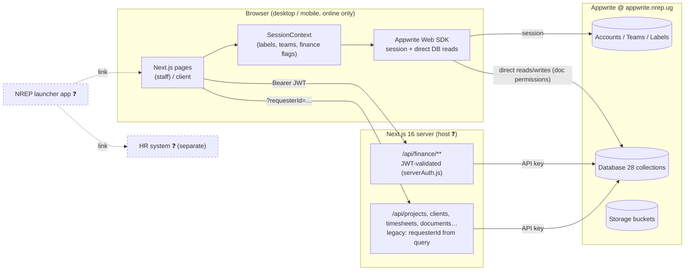
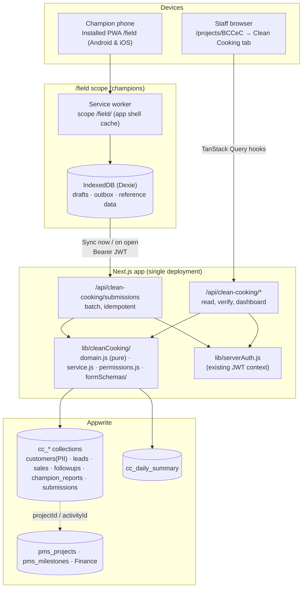
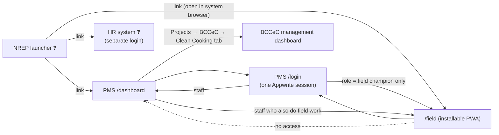
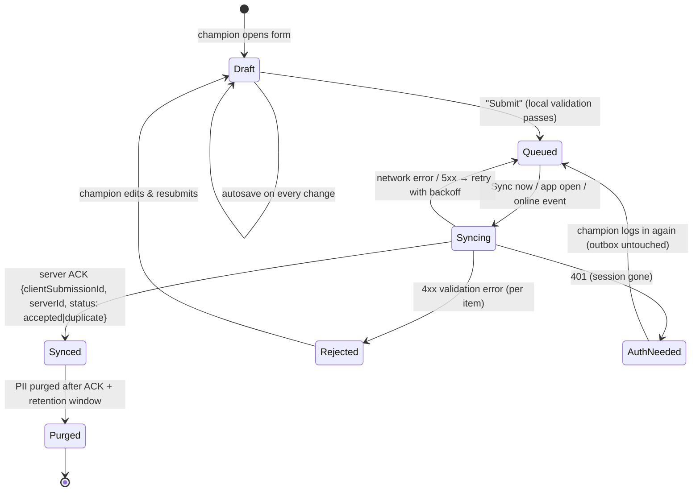
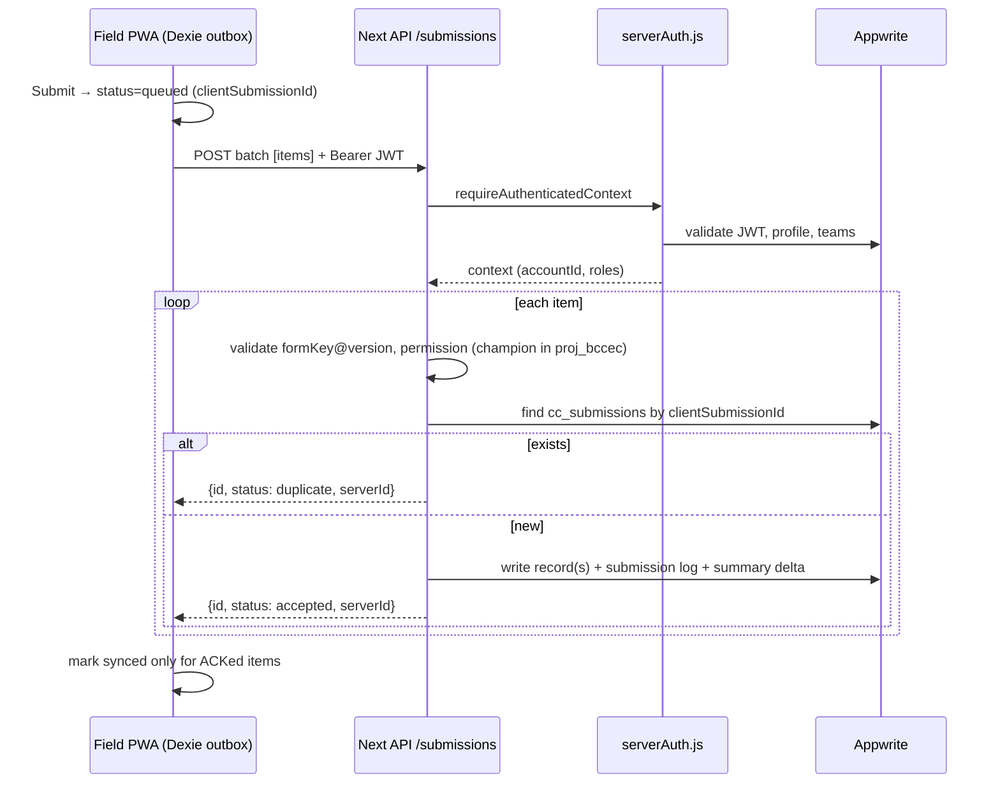
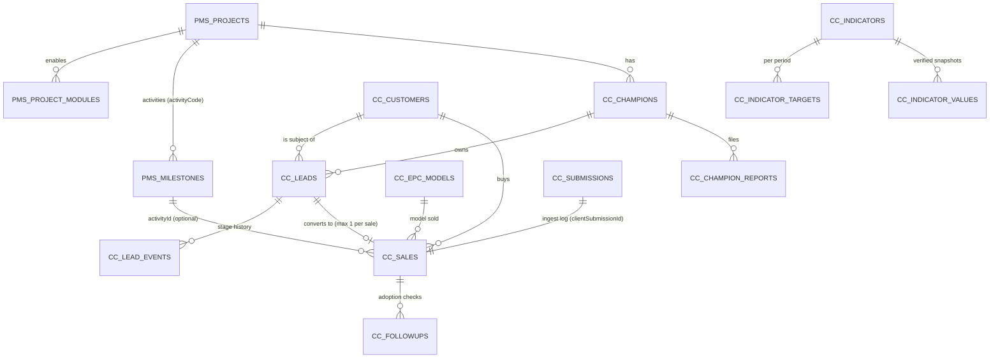

# NREP PMS — Architecture, Navigation & Cross-Platform Readiness Audit
## For the BCCeC Clean Cooking intervention (EPC sales, leads, champions, adoption, M&E)

| | |
|---|---|
| Repository | `NREP-PROJECT-MGT`, branch `redesign/nrep-ui` @ `5d1c6ed` |
| Audit date | 2026-11-12 |
| Scope | Assessment and planning only. No code, schema, dependency or deployment changes were made. |
| Live data access | Read-only queries against the configured Appwrite instance (`https://appwrite.nrep.ug`) to verify how BCCeC and the collections are actually stored. |

**Evidence labels used throughout**

- ✅ **Verified**: seen in the repository or the live Appwrite schema (file references given).
- 🟦 **Proposed**: a recommendation; nothing exists yet.
- 🟨 **Assumption**: believed to be true but not proven by evidence available here.
- ❓ **Unknown**: needs evidence that is not in this repository (listed in §18).

---

## 1. Executive Summary

1. **The existing Next.js + Appwrite PMS can host the Clean Cooking module without restructuring.** BCCeC already exists as a project (code `BCCeC`, Appwrite team `proj_bccec`, 5 components). The project → component → activity hierarchy (with activity codes and Finance budget lines) is the right place to hang new operational records. **Recommendation: build a dedicated BCCeC Clean Cooking module inside the existing app (Option B), plus a separate `/field` route group installed as a PWA for champions.** Ship it from the same deployment. A separate hostname can point at the same deployment later if wanted.
2. **There is no offline or PWA capability today.** ✅ There is no manifest, no service worker and no IndexedDB use (`public/` contains only `images/`). Offline-first field reporting is entirely new work.
3. **Two blockers must be fixed before field data collection starts:**
   - ✅ **Security:** the older API routes trust caller identity taken from the query string (`requesterId`, `accountId`, even `labels`). For example, [app/api/timesheets/reports/route.js:63-91](../app/api/timesheets/reports/route.js#L63-L91) reads `labels` from the URL and grants admin behaviour if it contains `"admin"`. Twelve routes have no authorization check at all (§4). Customer personal data must not be added to a system with this pattern. The newer Finance routes already use a sound pattern ([lib/serverAuth.js](../lib/serverAuth.js) validates the Appwrite JWT on the server), and **all new BCCeC APIs must use only that pattern**.
   - ✅ **Device features are blocked:** [next.config.js:10](../next.config.js#L10) sends `Permissions-Policy: camera=(), microphone=(), geolocation=()`. This disables in-browser camera capture and GPS, which field forms will probably need.
4. ✅ **There is an orphan `pms_field_reports` collection** in the live database (created 2026-07-23, types `activity | incident | btor`, multi-level approval fields, **0 documents**). It isn't in [lib/collectionsDefinition.js](../lib/collectionsDefinition.js) and no code references it. The empty folders `components/field-reports/` and `components/reports/` suggest an abandoned start. Decide whether to retire it or reuse it (§11); don't build next to it by accident.
5. ❓ **The NREP launcher app and the HR system are not in this repository.** Navigation recommendations below are conditional. Linking between systems **does not** give single sign-on. Each system currently keeps its own session.
6. **iOS is the limiting platform.** An installed PWA is enough for both Android and iOS **if** sync is manual-first ("Sync now" plus sync when the app opens). Background Sync is not available on iOS. Native apps are not needed for the stated requirements.

---

## 2. Verified Current Architecture

### 2.1 Stack ✅
| Item | Evidence |
|---|---|
| Next.js **16** (`^16.1.6`), React 19, **App Router** | [package.json](../package.json). Note: [README.md](../README.md) still says "Next.js 14", which is stale. |
| **JavaScript only** (no TypeScript), `@/*` path alias | [jsconfig.json](../jsconfig.json) |
| UI: Bootstrap 5 + react-bootstrap + bootstrap-icons; CSS modules; Recharts; jsPDF / html2canvas for exports | [package.json](../package.json), [components/ui/](../components/ui/) |
| Data fetching: TanStack Query v5 (provider in [components/QueryProvider.js](../components/QueryProvider.js)) | Only **6 files** use `useQuery`; **32** page/component files call `fetch` directly; **20** files call Appwrite `databases.*` directly from the browser (§4) |
| Backend: Next.js Route Handlers (`app/api/**`, ~75 routes) + Appwrite (self-hosted at `appwrite.nrep.ug`) using `node-appwrite` with an API key on the server | [lib/appwriteAdmin.js](../lib/appwriteAdmin.js) |
| Email via nodemailer | [lib/nodemailer.js](../lib/nodemailer.js) |
| Tests: one file, Node's built-in runner, Finance domain only | [tests/financeDomain.test.cjs](../tests/financeDomain.test.cjs), `npm test` |
| Logging: `console.error` (~225 call sites), no structured logging, metrics or tracing | grep |
| Deployment config: **none in repo** (no `vercel.json`, Dockerfile or CI workflow). `.env.local` has `NEXT_PUBLIC_APP_URL=http://localhost:3000` | ❓ production host unknown |
| PWA / offline: **none** | No manifest, no service worker, nothing in `public/` except `images/` |

### 2.2 Route structure ✅
```
app/
  layout.js                 QueryProvider → SessionProvider
  page.js                   client redirect → /dashboard
  login, logout, forgot-password, reset-password, auth/callback
  (staff)/layout.js         client-side guard: no user → /login, client → /client/dashboard
    dashboard, projects/[id]/{components,milestones,tasks,team,timesheets,settings,edit}
    clients, timesheets/*, finance/*, admin/*, profile
  client/layout.js          client-portal guard
  api/**                    Route Handlers (Finance = JWT-validated; legacy = see §4)
```
- ✅ There is **no `middleware.js`**. All route protection is client-side in layouts ([app/(staff)/layout.js](../app/(staff)/layout.js)). That's acceptable only because the data APIs enforce access themselves, which is not true of the legacy routes.
- ✅ [app/api/auth/session/route.js](../app/api/auth/session/route.js) reads an `appwrite-session` cookie "for middleware", but no middleware exists. Login creates the session in the browser SDK ([lib/auth.js:194](../lib/auth.js#L194)), so that cookie is scoped to the Appwrite domain and not to the Next.js host. **This route is effectively dead code.**

### 2.3 Authentication & RBAC ✅
| Layer | Mechanism | Evidence |
|---|---|---|
| Login | Appwrite email/password session in the browser SDK | [lib/auth.js:194](../lib/auth.js#L194) |
| Client session object | `SessionContext` assembles profile, teams, labels and finance flags in the browser | [contexts/SessionContext.js](../contexts/SessionContext.js) |
| API auth (**new pattern**) | Browser mints an Appwrite JWT (cached ~12 min) and sends `Authorization: Bearer`. The server validates it against Appwrite, then checks the profile is active, org team membership is `org_*`, and finance roles come from org membership roles | [lib/apiClient.js](../lib/apiClient.js), [lib/serverAuth.js:36-129](../lib/serverAuth.js#L36-L129), [lib/financeRoute.js](../lib/financeRoute.js) |
| API auth (**legacy pattern**) | `verifyStaffAccess(requesterId)` etc., where `requesterId` comes from the **query string**, so identity is not proven | [lib/authHelpers.js](../lib/authHelpers.js), e.g. [app/api/projects/route.js:23-33](../app/api/projects/route.js#L23-L33) |
| Org roles | Appwrite **labels**: `admin`, `manager`, `staff`, `client` | [lib/rbac.js:12-17](../lib/rbac.js#L12-L17) |
| Project roles | Appwrite **Teams** per project (`proj_*`) with roles `owner/manager/contributor/viewer/client_rep`, plus configurable `pms_project_roles` | [lib/rbac.js:22-28](../lib/rbac.js#L22-L28), [lib/projectRoles.js](../lib/projectRoles.js) |
| Finance roles | Derived from **org team membership roles** (`deriveOrganizationFinanceAccess`) | [lib/financeDomain.js](../lib/financeDomain.js), [lib/serverAuth.js:94-105](../lib/serverAuth.js#L94-L105) |
| Document-level security | Appwrite permissions built per resource | [lib/rbac.js:104-163](../lib/rbac.js#L104-L163) |

### 2.4 Project / activity data model ✅ (verified in live schema)
```
pms_organizations ─┐
pms_clients ───────┤
pms_projects  (code, name, status, budgetAmount, budgetCurrency, projectTeamId, clientId)
  ├─ pms_project_components (projectId, name, leaderId)
  ├─ pms_milestones  = "Activity Schedules" (projectId, name, status, components[] ,
  │                    activityCode, parentActivityId, sortOrder)          ← Finance "activities"
  │     └─ pms_tasks (projectId, milestoneId, assignedTo[], status)
  ├─ pms_budget_lines / pms_expenditures / commitments / reallocations … (Finance)
  ├─ pms_documents / folders / versions, pms_embeds
  └─ pms_timesheets / pms_timesheet_entries
pms_field_reports   ← orphan: in DB, not in code (0 docs)
```
Note that activities link to components through an **array** (`components[]`) on the activity, not a `componentId` foreign key.

### 2.5 How BCCeC is represented ✅ (live, read-only)
| Field | Value |
|---|---|
| Project | `Behavioral Change Communication Project for E-cooking`, code **`BCCeC`**, id `69fd9a27002691fecf72`, status `active`, 2024-07-01 → 2027-03-31, GBP 1,550,000 |
| Project team | `proj_bccec` |
| Components (5) | Identification of Key Demographic Groups · Development of Tailored Messaging and Communication Channels · **Implementation of Outreach and Engagement Activities** · **Monitoring, Evaluation, Application and Learning Activities** · Knowledge Management (KM) Activities |
| Activities | 1 (`Test Activity`, no activity code) |
| Finance budget lines / expenditures | 0 / 0 |
| Other projects | P4FP (Power for Food Partnership), RETC, Finance demo project |

The **activity layer for BCCeC is effectively empty**. That's an opportunity: activity codes for the Clean Cooking work can be set up correctly from day one.

### 2.6 Current architecture diagram


---

## 3. Existing Architecture Strengths ✅

1. **A solid server-side auth context already exists.** [lib/serverAuth.js](../lib/serverAuth.js) validates the JWT with Appwrite, checks profile status, and derives org membership and roles from Appwrite Teams rather than from request input. New modules can reuse it directly.
2. **Activity codes and Finance are already linked to activities** ([lib/financeSchema.cjs:61-71](../lib/financeSchema.cjs#L61-L71)). Field records can carry `activityId`, and cost-per-sale or cost-per-lead reporting becomes possible.
3. **Idempotent, additive schema tooling exists** ([scripts/deploy-finance-schema.js](../scripts/deploy-finance-schema.js), [lib/collectionHelpers.js](../lib/collectionHelpers.js)). A `deploy-clean-cooking-schema.js` can follow the same pattern.
4. **The Finance service shows good domain separation**: pure domain rules in [lib/financeDomain.js](../lib/financeDomain.js) (unit-testable) and I/O in [lib/financeService.js](../lib/financeService.js). Copy this for Clean Cooking.
5. **Consistent API error envelope**: `HttpError` + `apiErrorResponse` hide internals on 500s ([lib/serverAuth.js:163-185](../lib/serverAuth.js#L163-L185)).
6. **Security headers already exist** (`X-Frame-Options: DENY`, `nosniff`, Referrer-Policy) in [next.config.js](../next.config.js).
7. **The responsive shell has a mobile drawer sidebar** ([components/Sidebar.js](../components/Sidebar.js), `@media` rules in [components/AppLayout.module.css](../components/AppLayout.module.css)) and `aria-*` attributes are in use (64 occurrences).
8. **Project teams per project** (`proj_bccec`) give a natural place to grant champions access scoped to BCCeC.

---

## 4. Architectural Weaknesses and Technical Debt

| # | Finding | Evidence | Severity |
|---|---|---|---|
| W1 | **Client-supplied identity is trusted.** Legacy routes authorize using `requesterId` / `accountId` from the query string. Anyone with a valid user ID (IDs appear in URLs and payloads) can act as that user. `timesheets/reports` also trusts a `labels` query parameter. | [lib/authHelpers.js:32-110](../lib/authHelpers.js#L32-L110); [app/api/projects/route.js:23-33](../app/api/projects/route.js#L23-L33); [app/api/timesheets/reports/route.js:63-91](../app/api/timesheets/reports/route.js#L63-L91); callers e.g. [hooks/useProjects.js:149](../hooks/useProjects.js#L149) | **Critical** |
| W2 | **Routes with no authorization check**: `documents/[documentId]`, `documents/[documentId]/version`, `projects/[id]/timesheets`, `timesheets/{approvals,dashboard,details,entries/[id],reminders,reports,staff/[accountId],team,templates}`. They use the server API key, which bypasses document permissions. | grep of `app/api/**/route.js` | **Critical** |
| W3 | **Two auth systems side by side** (JWT vs `requesterId`). New contributors may copy the wrong one. | [lib/serverAuth.js](../lib/serverAuth.js) vs [lib/authHelpers.js](../lib/authHelpers.js), [lib/authServer.js](../lib/authServer.js) | High |
| W4 | **Browser reads and writes the DB directly** in 20 files (e.g. dashboard, milestones, tasks, admin users). Correctness depends entirely on Appwrite document permissions. Business rules are split between the browser and the API. | e.g. [app/(staff)/dashboard/page.js](../app/(staff)/dashboard/page.js), [app/(staff)/projects/[id]/milestones/new/page.js](../app/(staff)/projects/[id]/milestones/new/page.js) | High (for PII) |
| W5 | **Data fetching is inconsistent**: TanStack Query in 6 files, raw `fetch` + `useEffect` in ~32. The project standard in `CLAUDE.md` calls for TanStack Query hooks. | grep | Medium |
| W6 | **Only client-side route protection**, no middleware. A flash of protected UI is possible, and APIs carry the full burden (see W1/W2). | [app/(staff)/layout.js](../app/(staff)/layout.js) | Medium |
| W7 | **Dead or stale artifacts**: `/api/auth/session` (cookie never present), empty `components/field-reports/` and `components/reports/`, orphan `pms_field_reports` collection, README says Next 14. | §2 | Low–Medium |
| W8 | **`Permissions-Policy` disables camera and geolocation** app-wide. | [next.config.js:10](../next.config.js#L10) | Medium (blocks field features) |
| W9 | **Large service module**: `financeService.js` is 2,338 lines. Fine today, but don't put Clean Cooking logic in it. | [lib/financeService.js](../lib/financeService.js) | Low |
| W10 | **Very thin test coverage**: Finance domain only; no API, authorization or UI tests. | [tests/](../tests/) | High (for a module handling PII and indicators) |
| W11 | **No observability**: no request IDs, structured logs or health endpoint. Field sync failures will be hard to diagnose. | grep | Medium |
| W12 | **Aggregation by paging through every document** (`listAllDocuments`) works at current scale but grows linearly. Appwrite has no `GROUP BY`. | [lib/financeService.js:120-130](../lib/financeService.js#L120-L130) | Medium (grows with field data) |
| W13 | **No deployment, CI or environment documentation in the repo.** | — | Medium |

---

## 5. BCCeC Integration Readiness

### 5.1 Where "Clean Cooking" should live in the hierarchy
| Option | Fit | Verdict |
|---|---|---|
| An **activity** (`pms_milestones`) | Activities are time-boxed, budgeted work items with codes. Clean Cooking is a whole stream of work containing many activities. | ✗ Too small |
| A **project component** | Components are BCCeC's existing workstreams. "Implementation of Outreach and Engagement Activities" already covers champion outreach. M&E has its own component. | ◐ Possible, but Clean Cooking cuts across 2–3 components |
| A **feature module enabled on the BCCeC project** (🟦 recommended) | One module record says "BCCeC has Clean Cooking enabled". Every operational record carries `projectId` (required), plus `componentId` and `activityId` (optional) for traceability and Finance linkage. | ✓ No new hierarchy level, and reusable if P4FP needs sales/leads later |
| A new sub-project | Would split Finance and team membership. | ✗ Invents hierarchy |

🟦 **Proposal:** a `pms_project_modules` record `{ projectId: BCCeC, moduleKey: 'clean_cooking', enabled: true, config }`. Each sale, lead, follow-up and champion report stores `projectId` and, where relevant, `activityId` (for example "Market activation – Kampala Q1", with an activity code). That ties results to the activity's budget lines. ❓ Ask M&E/Finance whether Clean Cooking also needs its **own component** for reporting. If it does, create it as a normal component (additive, no code change).

### 5.2 Effect on existing parts
| Area | Impact |
|---|---|
| Project detail page | Add a **"Clean Cooking"** tab shown only when the module is enabled ([app/(staff)/projects/[id]/page.js:143-170](../app/(staff)/projects/[id]/page.js#L143-L170) already renders conditional tabs). |
| Dashboards | The global `/dashboard` is untouched. BCCeC metrics stay inside the project. |
| Finance | Read-only link through `activityId`. No Finance schema change. Cost-per-sale is a later report. |
| Activities | Champions need activity *codes* to pick from. BCCeC needs real activities created (it currently has only a test activity). |
| Permissions | New project-team role(s) in `proj_bccec`, or a new org label (see §10). Existing roles are unchanged. |

---

## 6. Recommended Module Architecture

### 6.1 Options compared
| Criterion | A. Extend project detail pages | **B. Dedicated BCCeC module in the same app (+ `/field` PWA scope)** | C. Separate field frontend sharing the backend | D. Monorepo, independently deployed apps |
|---|---|---|---|---|
| Implementation complexity | Low | **Medium** | Medium–High (second app, shared auth) | High (workspace tooling, shared packages) |
| Maintainability | Poor; the project page grows into a monolith | **Good**; isolated `lib/cleanCooking`, `app/field`, `app/api/clean-cooking` | Medium; duplicated UI/auth glue | Good long term, costly now |
| Deployment independence | None | None (same deploy); a separate hostname is possible | Full | Full |
| Auth complexity | Low | **Low**; reuses `serverAuth.js` | Medium; cross-origin JWT, CORS, second Appwrite platform | Medium |
| Offline support | Hard; a service worker would cover the whole staff app | **Good**; SW scoped to `/field/` only | Good | Good |
| Cross-platform | Same | **Same PWA on Android and iOS** | Same | Same |
| Data consistency | Good | **Good**; one API and one DB | Good if it uses the same API | Good |
| Security | Weak if it inherits legacy routes | **Good** if new routes use the JWT pattern only | Good, but larger attack surface (CORS) | Good |
| Hosting | None | **None** | Second app to host | Multiple apps |
| Risk to existing functionality | Medium (edits core pages) | **Low**; additive routes | Low | Medium (repo restructure) |
| Long-term scalability | Poor | **Good**; can be extracted to C/D later | Good | Best |

🟦 **Recommendation: B.** All the evidence points this way. The JWT auth context, the Appwrite schema tooling and the Finance domain/service split can be reused unchanged. The team is small and the codebase is a single JS app with no monorepo tooling. A service worker scoped to `/field/` keeps offline behaviour out of the staff app. If champions later need a separately branded hostname, the same deployment can answer on `field.<domain>` (deployment option B, §13) without moving any code.

### 6.2 Proposed architecture


---

## 7. Existing NREP App & HR Navigation Assessment

### 7.1 What can be verified
- ❓ **The NREP entry-point (launcher) application is not in this repository.** Nothing in the code references it or the HR system. A grep for `hr`, `portal` and `launcher` found only unrelated text.
- ✅ The PMS has no SSO integration, no OAuth provider configuration and no `redirect` allowlist. The only redirect parameter is `/login?redirect=/client` in [app/client/layout.js](../app/client/layout.js).
- ✅ `X-Frame-Options: DENY` ([next.config.js:7](../next.config.js#L7)) means **the PMS cannot be iframed** by a launcher. Navigation into it must be top-level (link or WebView page load).

**Evidence needed to finish this section:** the launcher's repository or build (is it a website, PWA, Android APK with WebView, Capacitor or Flutter app?), the HR system's auth provider and Appwrite project (same `appwrite.nrep.ug` project or not), production hostnames for all three, and how users currently log in to each.

### 7.2 Navigation models
| | A. One entry portal with role-based links | B. PMS and HR separate; field inside PMS | C. Unified shell across independent deployments | **D. Hybrid: launcher + dedicated field URL + integrated dashboard** |
|---|---|---|---|---|
| User journey | Portal → tile → system | Champions open the PMS URL and get redirected to `/field` | One shell and nav bar; modules load inside it | Launcher tiles: *Project Management*, *HR*, *Field Reporting*. Champions mostly use the installed `/field` PWA icon. Staff use the PMS, where BCCeC → Clean Cooking is a tab. |
| Auth / session | Portal can't share sessions unless all systems use the same IdP or Appwrite project; each system logs in separately | One PMS session | Requires real SSO (shared IdP) | PMS and `/field` share **one Appwrite session** (same origin). HR stays separate until SSO exists. |
| Deep linking | Portal → system root | Good | Complex (shell routing) | Good: `/field/sales/new`, `/projects/<id>?tab=clean-cooking` |
| Back navigation | Leaves portal; back returns to it in a browser, not in a native shell | Normal | Shell-controlled | `/field` uses an in-app header back button (installed PWAs have no browser back on iOS) |
| Browser tabs | New tab per system | Single tab | Single tab | Field PWA is its own window; staff use normal tabs |
| Mobile nav | Portal grid | Staff sidebar is too heavy for champions | Shell nav | `/field` gets a bottom tab bar, large touch targets and no staff sidebar |
| Role-based visibility | Portal must know roles (needs SSO or its own login) | Sidebar filters by role ([components/Sidebar.js:84-86](../components/Sidebar.js#L84-L86)) | Shell must know roles | PMS decides after login: champion-only users always land on `/field`; staff see the BCCeC tab if they're in `proj_bccec` |
| Logout | Per system | One | Global (if SSO) | `/field` logout also **clears local drafts or encrypted data** (with an "unsynced data" warning) |
| Session expiry | Per system | One | Global | Field: offline work continues; sync asks for re-login (§9) |
| Cross-origin | Links only: fine | n/a | CORS, cookies, framing needed (and blocked by `X-Frame-Options`) | Same origin for PMS and field. Launcher only links. |
| Redirect security | Must allowlist return URLs | Internal only | Complex | Only relative internal redirects; reject absolute `redirect=` values |
| In-app vs external | Depends on the launcher ❓ | Browser | In-shell | Launcher should open `/field` in the **system browser** (Chrome / Safari) so the PWA can be installed and offline storage lasts. Not in an embedded WebView (§8 P). |

🟦 **Recommendation: D (hybrid).** It needs no SSO project and no launcher rewrite (the launcher only gains a link), and it gives champions a single home-screen icon. Staff stay in the system they already use. Real SSO across PMS and HR can come later as a separate decision.



---

## 8. Android and iOS Compatibility Assessment

Status column: **V** = verified platform behaviour (documented and stable), **T** = must be device-tested on target phones.

| Topic | Android (Chrome / installed PWA) | iOS (Safari / Home Screen web app) | Status |
|---|---|---|---|
| A. Install | Install prompt / menu → "Install app"; WebAPK created | Share → **Add to Home Screen** only (no prompt; Safari, and since iOS 16.4 other browsers too). Users need an in-app instruction card. | V |
| B. iOS requirements | — | HTTPS, manifest (`name`, `icons`, `start_url`, `display: standalone`), `apple-touch-icon`. Home-screen apps get **their own storage container, separate from Safari**: data entered in Safari does not appear in the installed app. Install first, then log in. | V |
| C. Service worker scope | Scope `/field/` set by script path or `scope` option | Same | V |
| D. Manifest | A field-specific `manifest.webmanifest` with `scope: "/field/"`, `start_url: "/field/"`, linked from the `/field` layout only, so the staff app is not installable by accident | Same | V |
| E. HTTPS | Required (except localhost) | Required | V |
| F. Offline shell / asset caching | Cache-first app shell + versioned assets | Same; cache can be evicted (see G/H) | V / T |
| G. IndexedDB & eviction | Best-effort storage, evicted under storage pressure; `navigator.storage.persist()` usually granted for installed PWAs | ITP may **delete script-writable storage after 7 days without use** for sites used in Safari. Home-screen web apps are exempt from that 7-day rule but can still be evicted under pressure. | V (rule), T (actual) |
| H. iOS lifecycle | — | Installed app is suspended when backgrounded, and JS doesn't run in the background. Reopening may reload the page, so drafts must autosave on every field change. | V |
| I. Background Sync | `SyncManager` supported in Chromium | **Not supported** (Safari/WebKit) | V |
| J. Manual sync fallback | **Sync now** + sync on app open + sync on `online` event | Same; **this is the main mechanism** | V |
| K. Refresh / close / reopen | IndexedDB survives; in-memory state is lost | Same | V |
| L. Auth while offline | Appwrite can't be reached, so the cached user profile is used for UI only; **all trust stays on the server at sync** | Same | V |
| M. Offline session expiry | JWT expires in ~15 min, which doesn't matter offline. At sync: mint JWT → if the session is gone, prompt login while **keeping the outbox intact** | Same | V |
| N. Camera / photos | `<input type="file" accept="image/*" capture="environment">` works without `getUserMedia`. **The current `Permissions-Policy: camera=()` must be relaxed for `getUserMedia` and geolocation** ([next.config.js:10](../next.config.js#L10)). Blobs stored in IndexedDB need compression (~200–400 KB). | Same; large blobs make eviction more likely | V / T |
| O. Entering from another app | Opening a URL from a native launcher goes to Chrome or a Custom Tab; the PWA may take over the link if installed | Opens in Safari or an in-app browser (SFSafariViewController), **not** the installed web app | V / T |
| P. Embedded WebView | Android WebView supports service workers if the host app allows it, but install and persistence behaviour differs | WKWebView supports service workers only for **App-Bound Domains** (iOS 14+), which needs host-app configuration | **T**: avoid relying on it |
| Q. APK on iOS | — | iOS can't install APKs. The only alternatives are an App Store or TestFlight build (native or Capacitor wrapper), Apple Business Manager custom apps, or the **PWA** | V |
| R. Native app needed? | No | No, for forms, offline queue, photos and GPS. Consider native only if you later need guaranteed background sync, MDM-managed devices, or long offline periods (weeks) with large photo sets. | Recommendation |

🟦 **Simplest reliable strategy:** one installable PWA at `/field` with **manual-first sync** (Sync now, on open, on reconnect). Use Background Sync opportunistically on Android only. Give champions an onboarding card ("Install → log in → test offline"). Pilot on the actual phone models champions own, especially low-RAM Android Go devices and an iOS 16/17 iPhone, before scaling (§17).

---

## 9. Offline-First Field Reporting Design

### 9.1 Existing infrastructure
✅ None. No service worker, manifest, IndexedDB library or sync code exists.

### 9.2 Technology choices (compatible with the stack)
| Need | Choice | Why |
|---|---|---|
| Local DB | **Dexie.js** (IndexedDB wrapper, ~30 KB) | Simple, mature, works on Safari, supports versioned schema migrations |
| Service worker | **Hand-written `public/field-sw.js`** (cache app shell + static assets, scope `/field/`) | Avoids build-plugin compatibility risk with Next 16 / Turbopack. 🟨 Serwist (`@serwist/next`) is an alternative to evaluate, but its Next 16 compatibility must be verified first |
| Form schemas | Versioned JS schema objects (`formSchemas/sale.v1.js`) shared by the PWA renderer and server validation | One source of truth; the server can still accept older versions |
| Server writes | One batch endpoint `POST /api/clean-cooking/submissions` | Fewer round trips on bad networks; per-item results |

### 9.3 Local record lifecycle


### 9.4 Rules
1. **Client-generated IDs:** each submission gets a `clientSubmissionId` (UUID v4 from `crypto.randomUUID()`) when it's created. The server stores it with a **unique index**. If the same ID arrives twice, the server returns the original `serverId` with `status: "duplicate"`. That makes retries idempotent.
2. **Never delete because an upload was attempted.** Mark `synced` only after a per-item server ACK. Keep synced items (without PII) for a retention window so the champion can see a history.
3. **Partial batch failures:** the server answers per item. The client updates each item independently.
4. **Retry:** exponential backoff (e.g. 5 s, 15 s, 60 s, 5 min, capped) while the app is open, plus manual Sync now. No infinite tight loops.
5. **Schema versioning:** every payload carries `formKey` and `formVersion`. The server keeps validators for at least N-1 versions. On a breaking change, drafts on the old version are shown as "update required".
6. **Duplicate detection (business level):** beyond retries, the server flags *probable duplicates* (same customer phone hash + EPC model + date within 3 days) as `needs_review` instead of rejecting them.
7. **Conflict resolution:** field records are **append-only** from the device. Champions create; supervisors and M&E edit or verify on the server. Edits to an already-synced record from the device become a *correction request*, so there is no last-write-wins race.
8. **Attachments** (photos, receipts): uploaded after the parent record is acknowledged, with their own idempotency key. The parent shows "photo pending" until done.
9. **Audit trail:** the server stores `submittedBy` (from JWT, never from payload), `deviceId`, `clientCreatedAt`, `serverReceivedAt`, `formVersion` and `payloadHash`. Verification actions are written to an append-only history.
10. **Storage pressure:** call `navigator.storage.persist()`, show used/quota (`storage.estimate()`), compress images, and warn when the outbox exceeds a threshold.
11. **Sensitive data in browser storage (honest limits):**
   - IndexedDB is **not encrypted by the app**. Anyone with the unlocked phone and browser access can read it.
   - 🟦 Mitigations: minimise PII on the device (name and phone only when consent = yes). Encrypt the PII fields in IndexedDB with WebCrypto AES-GCM using a key derived from a **short device PIN**, so the app locks after inactivity. **Purge PII after ACK.** On logout, wipe local data (with an unsynced warning).
   - **Lost or shared devices:** an admin can revoke all sessions for the user (Appwrite Users API) so nothing more can sync, but **local data can't be remotely wiped**. That's another reason for the PIN encryption and purge-after-sync. One login per champion; shared phones need explicit logout between users.

### 9.5 Submission sequence


---

## 10. Authentication and Role-Based Navigation

### 10.1 How champions should log in
| Option | Assessment |
|---|---|
| **Existing NREP (Appwrite) accounts with a dedicated field role** 🟦 | Reuses [lib/serverAuth.js](../lib/serverAuth.js) unchanged. A champion is an Appwrite user, a member of the org team (required by `requireAuthenticatedContext`) and of `proj_bccec` with role `field_champion`, plus an org label `field` so the UI routes them to `/field`. **Recommended.** |
| Dedicated field-reporter accounts in a separate system | Duplicates identity and breaks traceability to project teams |
| Shared identity across NREP apps / SSO | Only possible if HR uses the same Appwrite project or an external IdP is introduced ❓. Defer. |
| Independent auth with central authorization | More moving parts with no benefit at this scale |

**Required guard changes (🟦):**
- `StaffLayout` currently lets **any non-client** into all staff pages ([app/(staff)/layout.js:24-33](../app/(staff)/layout.js#L24-L33)). A champion account would see Projects, Timesheets and so on. Add: if the user has only the `field` label, redirect to `/field`.
- New APIs check *both* the field role and `proj_bccec` membership on the server, never from client flags.
- Customer PII endpoints check a `can_view_customer_pii` permission (M&E officer, project manager), not just "is on the project".
- Phone login, OTP or magic link may suit champions better than email and password. ❓ Confirm whether champions have email addresses.

### 10.2 Role-specific navigation (🟦)
| Role | Lands on | Sees | Never sees |
|---|---|---|---|
| Field champion | `/field` (PWA) | New sale · New lead · My leads (follow-ups due) · Adoption follow-up · Activity report · Outbox / Sync · Profile | Staff sidebar, other champions' customers, Finance, HR, Admin |
| Sales supervisor | `/field` + BCCeC → Clean Cooking | Team leads pipeline, reassign leads, verify sales, champion performance | Finance edit, Admin |
| BCCeC project manager | Project → Clean Cooking tab | All dashboards, verification, targets, exports (anonymised by default) | — |
| M&E officer | Clean Cooking → M&E | Indicators, targets vs actuals, verification queue, data quality alerts, PII (with consent) | Finance edit |
| Finance officer | Finance (existing) | Read-only Clean Cooking totals linked to activities | Customer PII |
| NREP administrator | Admin | User and role assignment, module enablement | — (PII only via audited access) |
| Senior management | BCCeC dashboard | Aggregates only, no PII | Individual records |

### 10.3 UX constraints for the field app
Small screens (≥ 360 px), one question group per screen, large tap targets (≥ 44 px), select lists rather than free text, works on 2G/EDGE (app shell under ~300 KB gzipped, no Recharts or jsPDF in the field bundle), English first with ❓ Luganda and other local languages if required, offline indicator always visible, and plain-language error messages.

---

## 11. Proposed Data Model (🟦 not created)

### 11.1 What needs M&E confirmation vs what can be designed now
| Can be designed independently now | Needs M&E / programme confirmation |
|---|---|
| Submission log, idempotency, audit, verification workflow | **Final data dictionary** (Kobo forms are still in review; the XLSForms have not been shared yet) |
| Lead stages (from review feedback: enquiry received → demonstration completed → quotation shared → financing pending → converted / closed without sale) | Indicator definitions, targets, disaggregation, reporting periods |
| Payment channel vs financing arrangement as **separate** fields | EPC model catalogue (brands, capacities, prices) |
| Consent fields (share identifiable details; follow-up contact) and anonymised path | Definition of "adoption" (frequency threshold, follow-up timing, e.g. 30/90 days) |
| Customer type (individual / institution) with age band only for individuals | Champion reporting period (weekly or monthly) and required fields |
| Attendance / participant log fields (from the NREP Activity Participant Log) | Whether sales attribution can be shared (champion + event + campaign) |

### 11.2 Entities


| Collection | Key fields (draft) | Notes |
|---|---|---|
| `pms_project_modules` | projectId, moduleKey, enabled, config | Generic; enables the module on BCCeC |
| `cc_champions` | projectId, accountId, displayName, district, subcounty, supervisorAccountId, status | Links to Appwrite user |
| `cc_customers` (**PII, restricted**) | projectId, customerType (individual / institution), name?, phone?, phoneHash, gender?, ageBand? (18–35 / 36+ / not known; individuals only), institutionType?, contactPerson?, district, consentShareIdentity (bool), consentFollowUp (bool), consentAt, consentRecordedBy | If `consentShareIdentity = false`, name and phone are **not stored**, only demographics. `phoneHash` (salted HMAC) enables deduplication without exposure. |
| `cc_leads` | projectId, activityId?, customerId?, championId, source (event / demo / referral / walk-in / media / other), sourceEventRef?, generatedAt, location, stage, mainBarrier, nextAction, assignedToAccountId, followUpDate, outcome, closedAt | `stage` enum from the review feedback |
| `cc_lead_events` | leadId, fromStage, toStage, at, by, note | Append-only; enables funnel and time-to-convert metrics |
| `cc_epc_models` | brand, model, capacityLitres, unitPriceUGX, active | Reference data, cached offline |
| `cc_sales` | projectId, activityId?, customerId, leadId? (**unique** when set), championId, epcModelId, quantity, unitPrice, saleDate, location (district / subcounty / GPS?), paymentChannel (cash / mobile money / bank), financingArrangement (full / instalments / loan / subsidy-grant), attributionChannel, verificationStatus (submitted / verified / rejected / needs_review), verifiedBy, verifiedAt | `paymentChannel` and `financingArrangement` are independent (review item 3) |
| `cc_followups` | saleId, customerId, scheduledFor, conductedAt, method (call / visit), usageStatus (in use / occasionally / not in use / not reached), usageFrequency, barriers[], behaviourIndicators (JSON per approved tool), conductedBy, verificationStatus | Only created if `consentFollowUp = true` |
| `cc_champion_reports` | championId, periodStart, periodEnd, outreachActivities[], demonstrationsCount, locationsVisited[], narrative, issues, status | **Lead and sale counts are derived, not typed** (§11.3) |
| `cc_submissions` | clientSubmissionId (**unique**), formKey, formVersion, deviceId, submittedBy, clientCreatedAt, serverReceivedAt, payloadHash, resultType, resultId, status | Idempotency and audit |
| `cc_indicators` / `cc_indicator_targets` / `cc_indicator_values` | code, name, definition, unit, disaggregations; target by period; value by period with `verifiedOnly=true`, computedAt, approvedBy | Values are **snapshots** approved by M&E |
| `cc_daily_summary` | projectId, date, district, championId, epcModelId, counters (leads_new, leads_converted, sales_qty, sales_verified_qty, followups_done, in_use…) | Aggregation (§12) |
| *(optional)* `cc_events` + `cc_attendance` + `cc_participants` | From the NREP Activity Participant Log | If BCCeC demos and outreach events also need attendance; can be shared with other projects |

### 11.3 Preventing double counting
1. **One fact, one source.** A sale is counted only from `cc_sales`. Champion reports **display** derived counts of that champion's leads and sales for the period rather than asking champions to retype them. Typed "self-reported" counts, if M&E wants them, are stored separately and labelled as self-reported.
2. **A lead converts at most once:** unique index on `cc_sales.leadId`. Sales without a lead are allowed (walk-ins) but flagged `attribution = direct`.
3. **Adoption references a sale.** Adoption rate = distinct sales with ≥ 1 follow-up `in use` ÷ distinct verified sales followed up. Repeated follow-ups don't inflate it.
4. **Unique customers** via `phoneHash` (when consented) or a manual merge by M&E. Anonymised sales are counted as sales, never as unique people.
5. **Retry duplicates** are removed by `clientSubmissionId`. **Business duplicates** are flagged `needs_review` (§9.4).
6. **Only `verified` records feed indicator values.** Dashboards show *submitted* and *verified* side by side.

### 11.4 What happens to `pms_field_reports`?
✅ It's empty and has no code. 🟦 Don't reuse it for sales or leads: its shape (`activity | incident | btor` narrative reports with two-level supervisor approval) fits *back-to-office / incident reports*, not structured transactions. Options: (a) leave it for a future BTOR feature and add it to `collectionsDefinition.js` so it isn't an orphan, or (b) delete it after confirming no other system writes to it ❓. No action is needed for Clean Cooking.

---

## 12. Dashboard Aggregation Strategy

### 12.1 Scale (🟨 assumption, to confirm)
Tens of champions, a few thousand leads and sales per year, and follow-ups of the same order. That's small for a database but **too large to page through on every dashboard load** with the current `listAllDocuments` pattern, which costs one request per 100 docs (W12).

### 12.2 Recommendation
| Layer | Approach |
|---|---|
| Write path | In the same API handler that accepts a record, **apply a delta to `cc_daily_summary`** for the affected (date, district, champion, model) row. |
| Rebuild | `scripts/rebuild-clean-cooking-summary.js` (idempotent) recomputes summaries from source records. Run it nightly or on demand to correct drift, and after verification changes. |
| Read path | Dashboards read summaries only (small), cached client-side with TanStack Query (`staleTime` ~5 min). Drill-down lists are paginated queries on source collections with indexes. |
| Indicators | Computed from **verified** records into `cc_indicator_values` per period, then reviewed and **approved by M&E**. Dashboards show approved values as "official" and live values as "provisional". |

### 12.3 Dashboard content (Clean Cooking tab)
- KPI tiles: EPCs sold (submitted / verified), leads generated, conversion rate, follow-ups due or overdue, % in use.
- Sales trend by week or month; mix by EPC model and capacity.
- **Lead funnel** by stage, conversion rate by source (event, demo, referral), median days to convert.
- Champion performance table: leads, sales, conversion, follow-up completion, last sync date.
- Geography: by district and sub-county (a table first; a map later if needed).
- Activity-level: results per `activityId` alongside the activity's Finance spend (read-only link).
- Targets vs actuals per indicator and period.
- **Data quality:** pending verification count, probable duplicates, champions not synced in more than N days, missing consent, records rejected.
- **Privacy:** every management view uses aggregates or anonymised rows by default. Individual customer details only appear in the PII-permissioned drill-down, and exports default to anonymised.

---

## 13. Deployment Options Comparison

| | **A. Single deployment, separate routes** 🟦 now | B. One codebase, multiple hostnames 🟦 optional later | C. Separate frontends, shared backend | D. Monorepo, independent apps |
|---|---|---|---|---|
| Field URL | `https://<pms-host>/field` | `https://field.<domain>` → same deployment; host-based redirect to `/field` | Separate app | Separate app |
| HTTPS / domains | Existing | Add DNS + certificate | Add | Add |
| Cookies / origins | Same origin, same Appwrite session | **Different origin means a separate login on that host** (browser storage and session are per origin) | Separate | Separate |
| Appwrite platform | Existing Web platform | Add the hostname as a Web platform in Appwrite | Add | Add |
| PWA scope | `/field/` | `/` on the field host | Own | Own |
| SW boundaries | SW scoped `/field/` never touches staff pages | Clean | Clean | Clean |
| CORS | None | None if the API is on the same host | Required | Required |
| Cost / CI | None extra | Minimal | Extra build / deploy | Extra tooling |
| Rollback | One deploy | One deploy | Two | Many |

🟦 **Recommendation:** start with **A**. Move to **B** only if champions need a short, memorable URL. Note that with B, staff who also do field work log in once per host. ❓ `field.nrep.ug` is **not assumed to exist**; it needs a DNS record, a certificate and an Appwrite platform entry.

**Environment management:** add a **staging** Appwrite project or database (the schema scripts already read collection IDs from env), a staging deployment for device pilots, and document the production host and deploy process (W13). **Rollback:** additive collections and routes mean rolling back the app deploy is safe. Schema additions are left in place (no destructive down-migrations needed).

---

## 14. Impact and Risk Matrix

| Change | Risk | Why | Mitigation |
|---|---|---|---|
| New `cc_*` collections + `pms_project_modules` | **LOW** | Additive; no existing collection altered | Idempotent deploy script modelled on `deploy-finance-schema.js`; staging first |
| New `/api/clean-cooking/*` routes using `serverAuth.js` | **LOW** | Isolated; proven auth path | Route tests for authz (champion vs non-member vs other project) |
| New `/field` route group + manifest + SW scoped `/field/` | **LOW–MEDIUM** | Scope keeps the SW off staff routes. A bad SW can cache stale field builds. | Versioned cache names, `skipWaiting` with an "update available" banner, a kill-switch SW |
| Project detail "Clean Cooking" tab | **LOW** | Conditional render in an existing tab list | Feature flag from `pms_project_modules` |
| `StaffLayout` redirect for field-only users | **MEDIUM** | Touches the guard every staff page uses | Narrow rule (only users whose sole role is `field`); tests |
| Relax `Permissions-Policy` for camera / geolocation | **MEDIUM** | App-wide header | Scope the relaxed header to `/field/:path*` only in `next.config.js` `headers()` |
| New label / role `field` + project role `field_champion` | **MEDIUM** | Interacts with Sidebar / `isStaff` logic ([lib/rbac.js:55-60](../lib/rbac.js#L55-L60)) | Champions get **no** `staff` label; review every `isStaff` / `!isClient` check |
| **Fix legacy `requesterId` / no-auth routes (W1/W2)** | **HIGH** (change) but **CRITICAL** (not changing) | Touches ~30 routes and their callers; behaviour changes | Migrate route by route to `requireAuthenticatedContext`. Keep the response shape; add tests. **At minimum, no Clean Cooking feature may depend on legacy routes**, and customer data must never be reachable from them. |
| Finance linkage via `activityId` | **LOW** | Read-only reference | — |
| Launcher link to `/field` | **LOW** ❓ | Depends on the launcher implementation | Open in system browser |
| Retire `pms_field_reports` | **LOW–MEDIUM** | Unknown external writers ❓ | Confirm first; export the schema; delete only with approval |
| Dashboard summaries | **MEDIUM** | Drift if a delta fails | Nightly rebuild script + "last rebuilt" timestamp |

Breaking changes: **none** required by the Clean Cooking module itself. The only behaviour-changing work is the recommended security hardening of legacy routes.

---

## 15. Recommended Folder and Route Structure (🟦)

```
app/
  field/                                  # Champion PWA (scope /field/)
    layout.js                             # mobile shell, bottom tabs, manifest <link>, SW registration, field-role guard
    page.js                               # Home: due follow-ups, outbox status, quick actions
    sales/new/page.js
    leads/page.js · leads/new/page.js · leads/[localId]/page.js
    followups/page.js · followups/[localId]/page.js
    reports/new/page.js                   # champion periodic report
    outbox/page.js                        # drafts, queued, failed, synced + Sync now
    install/page.js                       # Android/iOS install instructions
  (staff)/projects/[id]/clean-cooking/    # or a tab inside projects/[id]/page.js
    page.js                               # dashboard
    sales/page.js · leads/page.js · champions/page.js · followups/page.js
    verification/page.js · indicators/page.js · settings/page.js
  api/clean-cooking/
    submissions/route.js                  # POST batch, idempotent
    reference/route.js                    # EPC models, activities, champion profile (cached offline)
    sales/route.js · leads/route.js · followups/route.js · champion-reports/route.js
    verification/route.js · dashboard/route.js · indicators/route.js · export/route.js
lib/cleanCooking/
  schema.cjs                              # collection definitions (like financeSchema.cjs)
  domain.js                               # pure rules: stages, consent, dedupe, indicator math (unit-tested)
  service.js                              # Appwrite I/O
  permissions.js                          # role checks built on serverAuth context
  formSchemas/{sale,lead,followup,championReport}.v1.js
lib/offline/                              # client-only
  db.js (Dexie) · outbox.js · sync.js · crypto.js
hooks/useCleanCooking*.js                 # TanStack Query hooks (per CLAUDE.md)
public/field-sw.js · public/field/manifest.webmanifest · public/field/icons/*
scripts/deploy-clean-cooking-schema.js · scripts/rebuild-clean-cooking-summary.js
tests/cleanCookingDomain.test.cjs · tests/cleanCookingSubmissions.test.cjs
```

---

## 16. Phased Implementation Roadmap (🟦)

| Phase | Content | Exit criteria |
|---|---|---|
| **0. Decisions & hardening** (prerequisite) | Approve the decisions in §19. Obtain launcher, HR and hosting evidence. Lock the data dictionary with M&E (Kobo XLSForms). Fix or fence legacy auth routes (W1/W2), at least those touching projects, members, documents and timesheets. Set up a staging environment. | Signed-off dictionary v1; no unauthenticated routes; staging live |
| **1. Server foundation** | Schema script, `lib/cleanCooking` domain + service, submissions endpoint (idempotent), reference endpoint, verification workflow, unit + authz tests | Records can be created over the API by role; duplicate posts return `duplicate` |
| **2. Field PWA** | `/field` shell, Dexie outbox, forms (sale, lead, follow-up, report), Sync now, install page, PIN lock, PII purge, scoped Permissions-Policy | Device test matrix passes (§17) |
| **3. Management dashboard** | Clean Cooking tab, summaries + rebuild script, funnel, champion table, data quality, anonymised exports | Dashboard numbers equal a manual recount of the test data |
| **4. M&E indicators** | Indicators, targets, period snapshots, approval | M&E signs off on a reporting period end to end |
| **5. Pilot → rollout** | 3–5 champions for 2–4 weeks on their own phones, then onboarding for the rest. Launcher link added. | Sync success above 99%; no data loss; champion feedback addressed |

---

## 17. Required Testing and Acceptance Criteria

**Automated**
- Domain unit tests: stage transitions, consent rules (no PII stored when consent = no), age band only for individuals, payment vs financing independence, dedupe rules, indicator maths (verified-only).
- API authorization tests: champion of BCCeC ✓; staff not in `proj_bccec` ✗; champion reading another champion's customers ✗; finance officer reading PII ✗; identity always from JWT (payload `submittedBy` ignored).
- Idempotency: same `clientSubmissionId` × 3 → one record. A partial batch with one invalid item → others accepted.

**Device matrix (manual, documented)**
| Scenario | Android Chrome | Android installed | iOS Safari | iOS Home Screen |
|---|---|---|---|---|
| Install & launch offline | — | ✓ | — | ✓ |
| Create 20 records in airplane mode, kill app, reopen → all present | ✓ | ✓ | ✓ | ✓ |
| Sync after reconnect; no duplicates; ACK states correct | ✓ | ✓ | ✓ | ✓ |
| Session expired while offline → re-login → outbox intact | ✓ | ✓ | ✓ | ✓ |
| Photo capture, compression, upload after parent ACK | ✓ | ✓ | ✓ | ✓ |
| 7+ days unused → data still present (document actual behaviour) | ✓ | ✓ | ✓ | ✓ |
| Logout with unsynced items → warning; confirmed logout wipes PII | ✓ | ✓ | ✓ | ✓ |
| Low-end device (≤ 2 GB RAM) & 2G throttling: form usable, shell < 300 KB | ✓ | ✓ | — | — |

**Acceptance**
- No record is marked synced without a server ACK. No silent data loss in any device-matrix scenario.
- Dashboards separate *submitted* from *verified*. Indicator values use verified records only.
- Management views and exports show no customer identity unless the user has the PII permission and consent = yes.
- A champion account can't reach any staff page or API.

---

## 18. Open Questions and Missing Evidence

| # | Question / evidence needed | Owner |
|---|---|---|
| 1 | Launcher app: repository or build, technology (web / PWA / APK + WebView / Capacitor / Flutter), how it opens links | IT |
| 2 | HR system: hosting, auth provider, same Appwrite project or not | IT |
| 3 | Production hosting for the PMS (provider, domain, CI/CD, env management); is there a staging environment? | IT |
| 4 | Final data dictionary: Kobo XLSForms for sales, leads, champion reports, follow-ups (currently in review) | M&E |
| 5 | Approved indicator list, definitions, targets, periods, disaggregations (donor: FCDO via MECS) | M&E |
| 6 | Definition of "adoption" and follow-up schedule | M&E / Programme |
| 7 | Champions: how many, which phones (Android/iOS share, models), email addresses or phone numbers, shared devices? Typical offline duration? | Programme |
| 8 | EPC model catalogue and pricing; are subsidies or vouchers tracked? | Programme |
| 9 | Are champions NREP staff, contractors or volunteers? (affects org-team membership and data-protection agreements) | HR / Legal |
| 10 | Data protection: DPIA under Uganda's Data Protection and Privacy Act 2019, retention period, consent wording | Legal / M&E |
| 11 | Should existing Kobo data be imported (historical) or does collection switch fully to the PMS? | M&E |
| 12 | Who created `pms_field_reports` (2026-07-23), and does anything outside this repo write to it? | Dev team |
| 13 | Languages required for the field app | Programme |

---

## 19. Final Recommendation: **Extend** (with targeted refactoring)

**Extend** the existing Next.js + Appwrite PMS with a dedicated Clean Cooking module attached to the existing BCCeC project, plus an installable `/field` PWA scope, all from the current single deployment. Do **not** restructure into a monorepo or build native apps. **Refactor only where it is a prerequisite:** retire the client-trusted legacy auth routes before customer data enters the system, and scope camera and GPS permissions to `/field`.

### Architectural decisions requiring approval (priority order)
1. **Security precondition:** approve fixing or fencing the legacy `requesterId` / unauthenticated API routes (W1/W2) before any customer data is collected. *(Critical)*
2. **Module architecture:** Option B, a Clean Cooking module inside the PMS with a `/field` PWA scope and a single deployment (deployment option A).
3. **Hierarchy placement:** Clean Cooking as a **module enabled on BCCeC**, records traceable by `projectId` + optional `activityId`. Decide whether to also create a dedicated BCCeC component.
4. **Champion identity:** Appwrite accounts in the org team + `proj_bccec` with role `field_champion` and a `field` label. Confirm login method (email vs phone/OTP).
5. **Offline policy:** manual-first sync, append-only device records, PII encrypted with a device PIN and purged after ACK, logout wipes local data.
6. **Data protection:** consent model (share identity / follow-up), anonymised sales path, PII access limited to named roles, and a DPIA.
7. **Verification rule:** only verified records count toward indicators; M&E approves period snapshots.
8. **Aggregation:** write-time summary deltas + nightly rebuild (not live paging).
9. **Navigation:** hybrid model D; the launcher links to `/field` opened in the system browser; no SSO in this phase.
10. **`pms_field_reports`:** keep for a future BTOR feature (and add it to `collectionsDefinition.js`), or retire it after confirmation.
11. **Environments:** create staging (Appwrite project or database + deployment) before the device pilot.
12. **Optional later:** a separate `field.<domain>` hostname, and SSO across PMS and HR.
